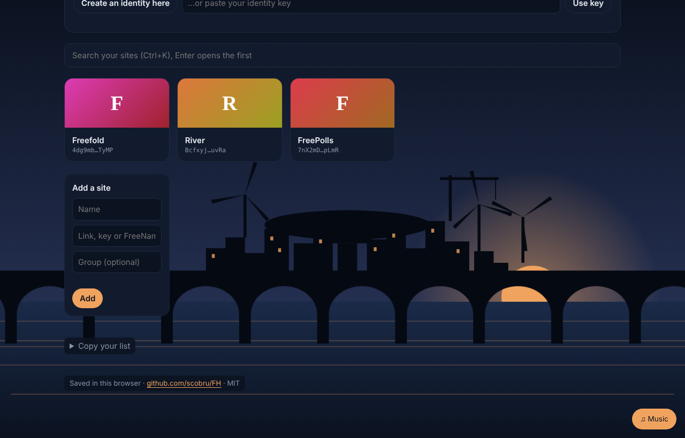

# FH

**Fisherman's Horizon**: a home page for [Freenet](https://freenet.org). Pin the Freenet sites you use, see them as tiles, open them from one place.

Named after the town on the bridge in Final Fantasy VIII: built from recycled parts, no army, everyone welcome.



## What it does

- **Tiles.** Add a site by pasting its link (`http://<node>/v1/contract/web/<key>/`, from any node, with or without an in-app `#route`), its bare contract key, or its [FreeNames](https://github.com/scobru/freenames) name (`scobru`, `scobru/freetunes`). A tile opens the site in a new browser tab and shows the site's `favicon.ico` when it has one.
- **Groups and order.** Give a site a group to put it under a heading. Drag a tile onto another to move it there (it takes that tile's group), or use the ← → buttons.
- **Search.** `Ctrl+K` (or `/`) jumps to the search box; Enter opens the first match, Escape clears it.
- **Same list on every node.** Sign in with your [Viso](https://github.com/scobru/viso) persona, or create an identity in FH (a key you back up and paste on another node). FH then keeps the list in a Freenet contract and, on each node, takes whichever list is newest. The list is **public**: anyone who knows your identity can read it.
- **Share your list.** Signed in, you get a link `#/u/<identity>`: whoever opens it sees your tiles and can add them, one by one or all at once.
- **App directory** (`#/apps`). A public list of Freenet apps that anyone signed in can add to, with a name and a one-line description. Add an app to your tiles with one click.
- **Copy your list.** Export the JSON, or import one.
- **The town on the bridge.** An original background scene (a railway bridge over the sea, a town of recycled parts, a great solar panel, turning windmills; light and dark versions) and an original calm ambient piece played live by the browser (`♪ Music`, off until you press it). Both were made for FH: no artwork or music from the game is included.

## How it works

- UI: TypeScript + Vite, no framework. One page, `src/main.ts`.
- List contract (`contract/`, Rust to WASM): one instance per identity. Parameters = persona public key (32 bytes) || app path (`/v1/contract/web/<FH id>/`). State is JSON `{ list, ts, sig, cert }`: the list string as signed, signed with `fhl1|<params_hex>|<ts>|<list>` by an app key, and `cert`, the persona's delegation of that key for this app path ([whoiam-delegation](https://github.com/scobru/freenames), as in FreePolls). Each node has its own app key; the newest signed list wins (ties broken by signature, so every merge order converges). Max 64 KB.
- App directory (`directory/`, Rust to WASM): one shared instance; parameters = admin public key (32 bytes) || app path. An entry is kept per (site, identity): `{ name, desc, ts, nonce, sig, cert }`, signed with `fhd1|<site>|<persona>|<name>|<desc>|<ts>` by a delegated app key, plus an 18-bit `sha256(message|nonce)` proof of work (a few seconds in the browser). Newest entry per identity wins, so merges converge; the page shows each site once, with the earliest listing's text. Up to 1000 entries (newest kept). The admin hides sites with a signed blocklist (`fhb1|<ts>|<keys>`), from the page `#/admin` (not linked anywhere). The admin key is `DIRECTORY_ADMIN` in `src/net.ts`, the same key as FreePolls' directory (messages are domain-separated); the secret is not in the repo.
- FreeNames: read-only lookup with FreeNames' own rules and contracts (`src/names.ts`, `src/net.ts`, `src/fn-zone.wasm` and `src/fn-registry.wasm` copied from the FreeNames repo). It needs FreeNames' published site key (`FREENAMES_KEY`) and the same contract code FreeNames publishes: if FreeNames changes its contracts, copy the new wasm files.
- Identity: as in FreePolls. *Sign in with Viso* asks Viso to sign `wd1.<app key>.<nonce>` for FH's address. *Create an identity here* makes an ed25519 key on the node and signs the same proof itself.
- Storage: FreePolls' identity delegate (`src/identity.wasm`, the same build as [`scobru/freepolls`](https://github.com/scobru/freepolls) `delegate/`). It keeps a small key/value store per calling web app, namespaced by the app's contract id as attested by the node, so other apps cannot read FH's list. FH only uses `get` / `put` of the key `sites`, never the signing key.
- Why not tabs inside FH: the node serves every app shell with `X-Frame-Options: DENY` (freenet-core `server/client_api.rs`), on purpose: the shell holds the app's identity token, so framing it would allow clickjacking. Framing the app's inner `?__sandbox=1` page instead would make FH proxy its socket under FH's own token, so every site would run as FH. A new tab escapes FH's sandbox and the node wraps the site in its own shell.

## Limitations

- Icons are only `favicon.ico` at the site's root; sites that declare another icon in their HTML show the letter.
- The directory's proof of work slows spam but does not stop a determined flooder; the admin blocklist is the backstop.
- No in-app tabs (see above). That needs a change in freenet-core, for example a shell that a trusted launcher may frame.
- Without sign-in, the list belongs to the node: a different node starts empty.
- The synced list is public, not encrypted.
- A Viso delegation does not expire and cannot be revoked yet: whoever controls a node you signed in from can rewrite your list.
- No unread badges or previews yet: FH does not read the sites' contracts.

## Roadmap

1. Encrypt the synced list.

## Development

```bash
# contracts: test, build, copy the wasm into the UI (needs the wasm32-unknown-unknown target)
cargo test
cargo build --release --target wasm32-unknown-unknown -p fh-list -p fh-directory
cp target/wasm32-unknown-unknown/release/fh_list.wasm src/contract.wasm
cp target/wasm32-unknown-unknown/release/fh_directory.wasm src/directory.wasm

npm install
npm test           # links, groups, Viso proof, FreeNames names, directory rules
echo VITE_NODE=127.0.0.1:7509 > .env.local   # optional: the node to use under npm run dev
npm run dev        # http://localhost:5173
```

## Publishing

```bash
npm run build
fdev website init fh              # once: creates the signing key. Back it up!
fdev website publish dist --key fh
# later releases:
fdev website update dist --key fh
```

`publish` prints the site URL, `http://127.0.0.1:7509/v1/contract/web/<key>/`.

## License

MIT, see [LICENSE](LICENSE).
